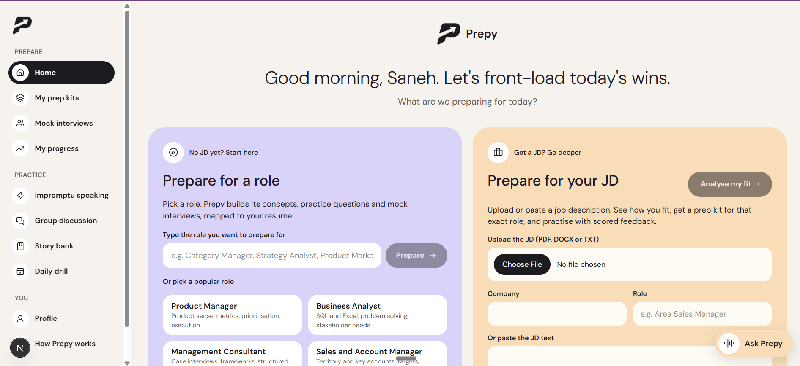
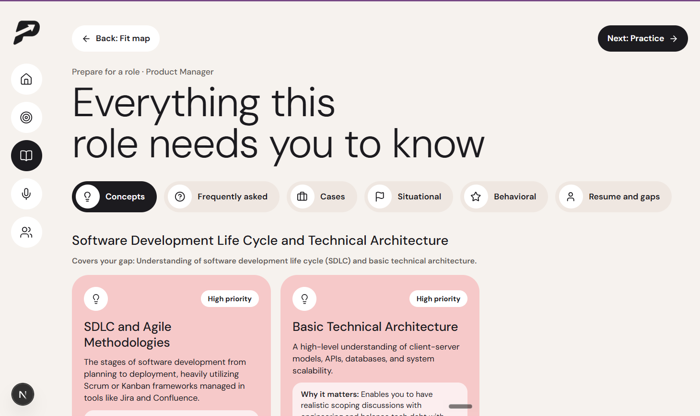
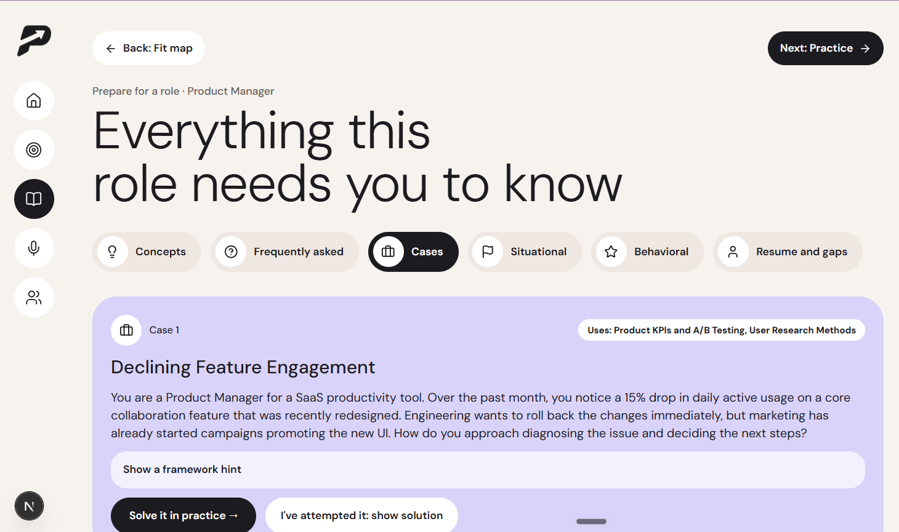
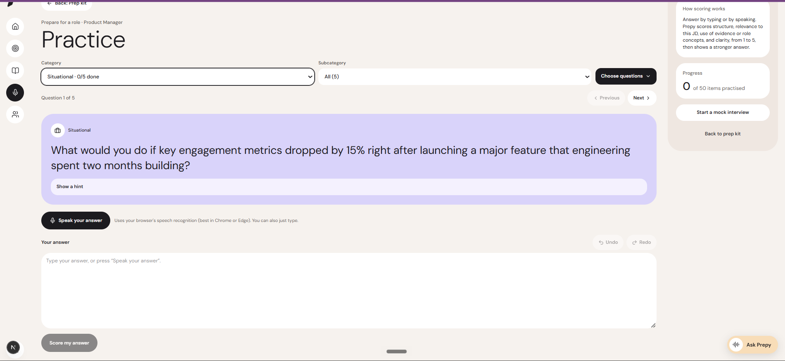
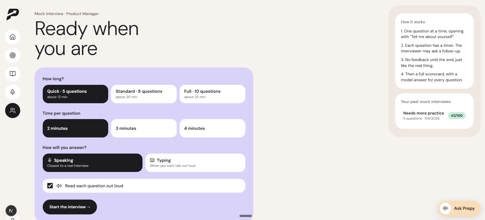
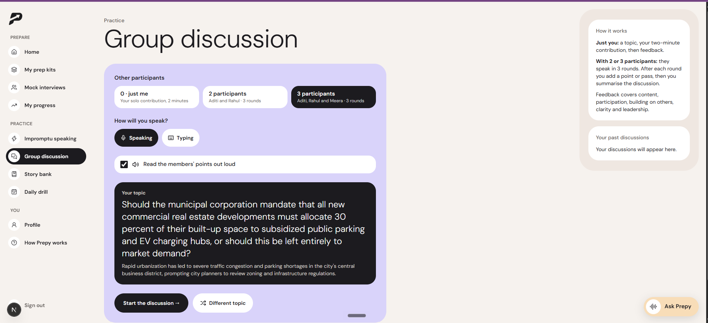
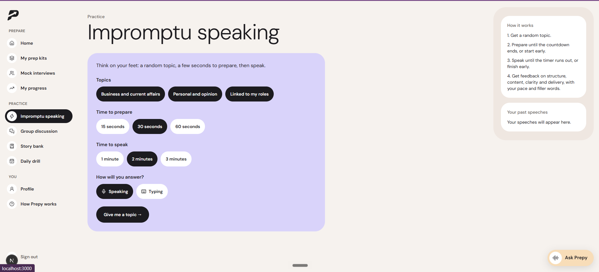

<p align="center">
  
</p>

<h1 align="center">Prepy</h1>

<p align="center">
  <strong>AI interview prep for MBA placements, built from your own story.</strong><br />
  Upload your resume once. Pick a role or paste a job description. Prepy maps your fit, builds a prep kit,
  and lets you practise by speaking, with honest, rubric-based feedback.
</p>

<p align="center">
  Next.js 16 · TypeScript · Tailwind CSS · SQLite · Auth.js · Gemini / Groq / Claude · Zod · Web Speech API
</p>

<p align="center">
  
</p>

---

## The problem

MBA placement season compresses dozens of interviews, across very different roles, into a few weeks. Candidates prepare with generic question banks that ignore both the specific job description and their own background. The usual AI shortcut, "write me an answer", is worse: it invents experience the candidate does not have, which falls apart at the first follow-up question.

## What Prepy does

| | Feature | What you get |
| --- | --- | --- |
| 1 | **Fit and Gap Map** | Every requirement in a JD (or a standard role profile) marked **Strong**, **Partial** or **Gap**, citing the exact resume line behind it, with a tip on how to use it in the interview. |
| 2 | **Prep for any role, with or without a JD** | Pick a common role (Product Manager, Business Analyst, Consultant, Sales, Marketing, Finance, Operations, HR), type any role, or upload a JD. |
| 3 | **Role prep kit** | Concepts grouped by topic, with **Read more** study notes (key topics, worked examples, common mistakes, likely questions); frequently asked questions; cases; situational, behavioral, resume and gap questions; a study plan. **Generate More** extends any section without repeats. |
| 4 | **Practice** | Answer by typing or **speaking** (live transcription, undo/redo). Rubric scores for structure, relevance, evidence and clarity, then a **model answer** written from your real resume. |
| 5 | **Mock interviews** | Timed questions read aloud, an opener of "Tell me about yourself", up to two **follow-ups** based on what you actually said, then a full scorecard with a verdict and per-question feedback. |
| 6 | **Impromptu speaking** | A fresh topic every time, a prep countdown, a speaking timer, and feedback with **pace (words per minute) and filler words measured exactly**. |
| 7 | **Group discussion** | Practise alone, or with 2–3 AI members who each have a distinct style (analyst, devil's advocate, consensus builder) over three rounds. Feedback on content, participation, building on others, clarity and leadership. |

Plus accounts (Google or email), onboarding from a resume, a sectioned profile, history for every practice mode, and a home page with a fresh, slightly cheeky MBA-flavoured greeting on every visit.

## Screenshots

<table>
  <tr>
    <td width="50%"></td>
    <td width="50%"></td>
  </tr>
  <tr>
    <td><strong>Role prep kit.</strong> Concepts grouped by topic, with priority and the gaps they cover.</td>
    <td><strong>Cases.</strong> Role-specific case studies with a framework hint, solved in practice.</td>
  </tr>
  <tr>
    <td></td>
    <td></td>
  </tr>
  <tr>
    <td><strong>Practice.</strong> Pick a category, answer by speaking or typing, get rubric scores and a model answer.</td>
    <td><strong>Mock interviews.</strong> Timed questions read aloud, follow-ups, and a full scorecard.</td>
  </tr>
  <tr>
    <td></td>
    <td></td>
  </tr>
  <tr>
    <td><strong>Group discussion.</strong> Practise alone or with 2–3 AI members over three rounds.</td>
    <td><strong>Impromptu speaking.</strong> A fresh topic, a prep countdown, then pace and filler-word feedback.</td>
  </tr>
</table>

## How the AI is kept honest

The core product rule is: **never invent the candidate's experience.** It is enforced in code, not only in prompts.

- **Grounded on numbered resume lines.** The profile is turned into numbered lines (`EX2.B4`, `ED1`, …). Every claim about the candidate must cite one.
- **Guards after every call.** A "Strong" fit without a valid citation is downgraded to "Partial". Citations that don't exist in the profile are dropped. Missing details become placeholders like `[add metric]` instead of guesses.
- **Validated output.** Every model response is parsed against a Zod schema, with one automatic repair retry.
- **Measured, not guessed.** Speaking pace and filler words are counted in code; the model only interprets them.
- **Evaluated.** An eval harness scores grounding (unsupported claims), relevance, concept coverage, role adaptivity and scoring consistency across sample JDs.

## Product decisions

Prepy was built as an MBA product-management project, so the decisions are documented like a product. A few examples (full log in [`docs/decision-log.md`](docs/decision-log.md)):

- **A guided workflow, not a chat box.** Resume → role or JD → fit → prep kit → practice. Each step has a clear output.
- **Role-agnostic from day one.** Placements cover sales, analytics, product, consulting and more; nothing is hard-coded to one role family.
- **Free to run.** Gemini and Groq free tiers, with automatic fallback between providers, timeouts and quota-aware routing, so practice keeps working when one free tier is busy.
- **Voice in the browser.** The Web Speech API gives speaking practice and read-aloud at zero cost, before investing in a real-time voice tutor.
- **Variety by design.** Topic generators combine a random theme and style per request and exclude topics already shown, so "Different topic" really is different.

## Architecture

```
Browser (Next.js App Router, React, Tailwind)
   │  guided pages: home · fit map · prep kit · practice · mock interview · impromptu · GD
   ▼
API routes ── withUser(): signed-in check + per-user data scope (Auth.js JWT sessions)
   │
   ├── prep / mock / impromptu / gd  orchestration, caching, grounding guards
   ├── prompts.ts                     21 versioned prompts (P1–P21)
   ├── llm.ts                         one callLLM(): JSON + Zod + retry + logging,
   │                                  Gemini → Groq → xAI → Anthropic fallback
   └── store.ts → SQLite (node:sqlite) every row carries a user_id
```

| Path | What |
| --- | --- |
| `src/app/` | Pages and API routes |
| `src/lib/llm.ts` | Model calls: provider fallback, timeouts, quota cooldown, schema validation, token logging |
| `src/lib/prompts.ts` | All prompts, each versioned so evals can compare versions |
| `src/lib/prep.ts` | Fit map, prep kit, grounding guards, practice queue, study plan |
| `src/lib/mock.ts`, `impromptu.ts`, `gd.ts` | Mock interviews, impromptu speaking, group discussions |
| `src/lib/db.ts`, `store.ts` | SQLite schema and a store scoped to the signed-in user |
| `src/auth.ts`, `src/proxy.ts` | Sign-in (Google + email/password) and route protection |
| `evals/` | Eval harness and labelled sample JDs |
| `docs/` | Decision log and setup guide |

## Run it locally

You need Node.js 22.13+ and a free Gemini or Groq API key.

```bash
git clone https://github.com/sanehkr08/Prepy-MBA-Placement-Prep-App.git prepy
cd prepy
npm install
cp .env.example .env.local   # add GEMINI_API_KEY (or GROQ_API_KEY) and AUTH_SECRET
npm run dev
```

Then open http://localhost:3000 in Chrome or Edge. Full instructions, including Google sign-in and the evals, are in [`docs/SETUP.md`](docs/SETUP.md).

## Roadmap

- **My progress:** scores over time and weakest areas across all practice.
- **Story bank:** reusable STAR stories drafted from the resume.
- **Daily drill:** one question a day to keep the habit.
- **Ask Prepy:** a real-time voice tutor.
- **Hosted demo** so it can be tried without installing.

## About

Built by **Saneh Kumar** as an MBA product-management project: from PRD and decision log to a working, tested product, built with an AI coding assistant.
